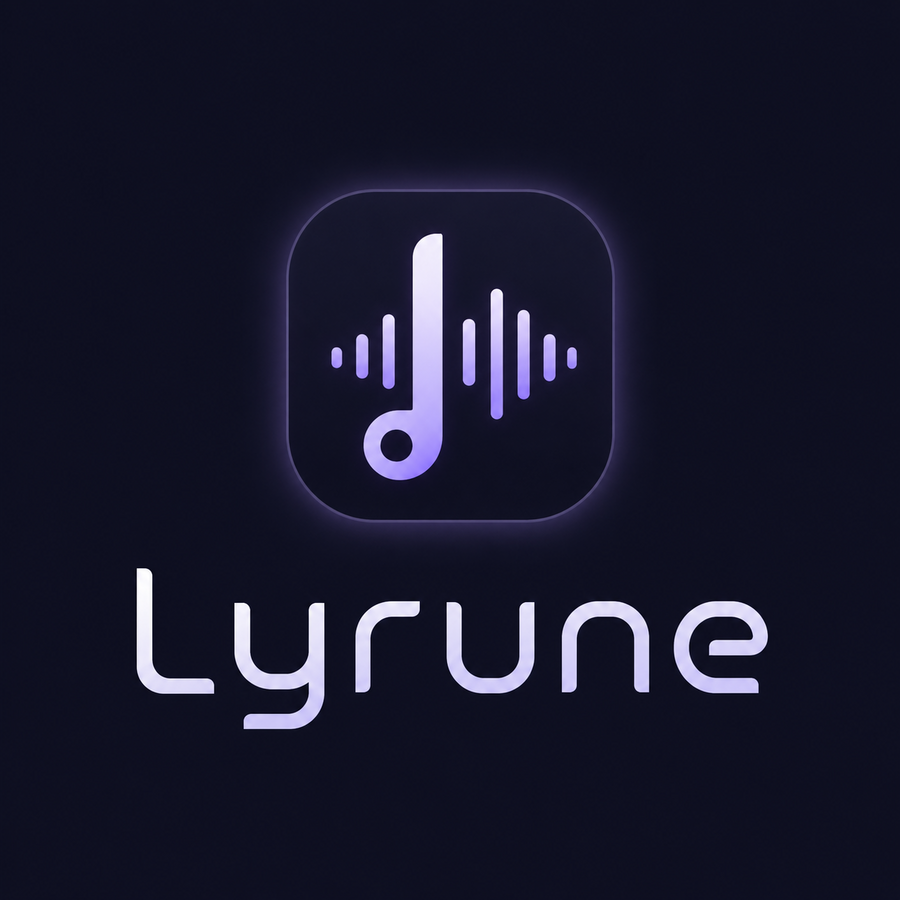

<div align="center">



# Lyrune

**Lyrune music player — Android and Windows, with real-time audio effects, synchronized lyrics, and an artwork-driven interface.**

[](https://developer.android.com/)
[](https://kotlinlang.org/)
[](https://github.com/sajjadraad2006-sys/Player/actions/workflows/android.yml)
[](LICENSE)

</div>

## Windows development branch

This branch (`codex/windows-product-rebuild`) contains the Windows app and the portable search/lyrics code it shares with Android. The repository's `main` branch remains the Android baseline.

The Windows app includes YouTube-only search with automatic playback, synchronized and imported lyrics, a desktop player and optional Now Playing panel, library collections and playlists, Audio Lab, themes, and English/Arabic presentation. Local playback includes MP3, WAV, FLAC, AAC/M4A, Opus/WebM, and OGG/Vorbis.

On Windows x64, use JDK 21 and configure the Android SDK through `ANDROID_HOME` or the untracked `local.properties` file, since the project also includes the Android module:

```powershell
.\gradlew.bat :desktopApp:run
.\gradlew.bat :desktopApp:test
```

The Python resolver runtime and native playback dependencies are bundled or fetched by Gradle; no system FFmpeg installation is required. Local paths, build output, and installer logs are excluded from Git. Android unit tests remain available with `:app:testDebugUnitTest` (the Android Python build requires Python 3.14 via `BUILD_PYTHON` or `local.properties`).

## What Lyrune does

- Plays an on-device music library through AndroidX Media3 and a media-session foreground service.
- Applies pitch, tempo, EQ, tone, stereo, 8D orbit, reverb, and limiting to actual decoded PCM.
- Renders a 24/48/64-band spectrum from a real post-DSP PCM tap—never from random or decorative data.
- Resolves embedded, sidecar, cached, and LRCLIB lyrics and follows genuine LRC timestamps.
- Offers independent System, Light, Dark, and true-black AMOLED appearance modes.
- Provides Glass, Minimal, Material, Neon, Dynamic Art, and Classic visual languages through shared design tokens.
- Supports in-app System Default, English, and Arabic locale selection with RTL resources.
- Searches and downloads optional online music sources without making network access a playback requirement.

## Online search

The primary online search experience uses YouTube. Selecting a result resolves supported audio internally and starts playback, with artwork and lyrics loaded automatically. The portable YouTube provider and lyrics lookup logic are shared with Android. Provider/runtime details are not part of the normal Windows search interface.

Optional development configuration belongs in the untracked `local.properties` file. Do not commit credentials or machine-specific SDK and Python paths.

## Audio Lab

The processing chain is:

```text
Media source → decoder → Media3 Sonic pitch/tempo → PCM studio processor
→ EQ/tone → stereo/8D → reverb → limiter → post-DSP PCM tap → AudioTrack
```

DSP bypass immediately restores Media3 default playback parameters and copies PCM without studio effects; it does not restart the track. The 8D modes use smoothed equal-power panning and crossfeed, including genuinely reversed clockwise/counter-clockwise motion and triangular ping-pong motion.

See [Audio engine notes](docs/AUDIO_ENGINE.md) for implementation details.

## Visualizer and synchronized lyrics

The visualizer analyzer runs away from the UI thread, reads the processor’s real sample rate, applies a Hann-windowed 2048-point FFT, maps logarithmic frequency bands, and emits real targets at a quality-dependent analysis rate. Compose interpolates those targets with elapsed frame time, so display refresh rate does not create or change spectrum energy.

Synced lyrics use a binary timestamp lookup with a separately stored per-track timing offset. The current line auto-follows playback; manual scrolling suspends follow mode, and tapping a timed line seeks to its real timestamp. Plain lyrics remain plain and missing lyrics are never generated.

## Themes

- **Glass** — translucent layered surfaces, artwork bleed, light borders, soft highlights, and floating navigation.
- **Minimal** — borderless cards, flat hierarchy, square artwork, restrained decoration, and quiet navigation.
- **Material** — opaque tonal containers, Material elevation, familiar shapes, and native selection states.
- **Neon** — dark surfaces with selective luminous edges and stronger active-control/visualizer emphasis.
- **Dynamic Art** — a cached palette extracted from current album artwork drives ambient surfaces and accents.
- **Classic** — compact outlined cards, traditional artwork corners, conventional separation, and restrained motion.

Appearance luminance and visual style are independent. AMOLED is an appearance mode, not a style override.

## Stem separation status

Lyrune offers real two-stem separation through the optional, user-downloaded `UVR-MDX-NET-Voc_FT.fp16acc.tflite` model. The 66,848,828-byte artifact is pinned to an immutable revision and SHA-256, stored privately, and loaded only when requested. It predicts vocals; instrumental is the complementary `original − vocals` residual from the same run.

Tracks are decoded and resampled off the playback thread, separated in chunks with LiteRT CPU/XNNPACK, overlap-added, gain-staged, written as synchronized WAV files, and cached by source/model/version. Both generated files can be played through the normal Media3 → DSP → visualizer path. Bass, drums, and other stems are not exposed because this is a genuine two-stem model. No filtering is marketed as AI separation.

## Architecture

```text
app/src/main/java/dev/auralis/studio/
├── audio/dsp/          # realtime PCM effects and limiter
├── audio/visualizer/   # lock-free PCM tap, FFT, temporal smoothing
├── audio/stems/        # pluggable offline separation/model contracts
├── core/               # models, Room, DataStore, repositories
├── lyrics/             # embedded/sidecar/cache/LRCLIB resolution
├── playback/           # Media3 connection, service and session
├── online/             # capability-separated catalogs, streams, downloads, merging
├── designsystem/       # luminance, semantic colors and style tokens
└── ui/                 # Compose screens, player, lyrics and visualizer
```

The legacy `dev.auralis.studio` namespace, application ID, database names, DataStore names, and compatibility keys are intentionally retained so the public rebrand does not break installed data.

## Technology

- Kotlin 2.0.21, coroutines and StateFlow
- Jetpack Compose and Material 3
- AndroidX Media3 1.5.1 / ExoPlayer
- Room 2.6.1 and DataStore 1.1.1
- Ktor 3.0.3 and Kotlin serialization
- Coil 2.7.0 and AndroidX Palette
- LiteRT 1.4.2 and JTransforms 3.1 for optional offline Voc_FT inference
- JDK 17 and Gradle wrapper

## Build

Requirements: JDK 17 and Android SDK Platform 36 for the current checked-in configuration.

```bash
./gradlew testDebugUnitTest
./gradlew lintDebug
./gradlew assembleDebug
```

Debug output:

```text
app/build/outputs/apk/debug/Lyrune-debug.apk
```

CI runs unit tests, Android lint, and the debug build without signing credentials.

## Status and roadmap

Working today: local library, queues, playlists, favorites, MediaSession controls, PCM DSP, real FFT visualization, offline-first lyrics lookup, synced lyric following, themes, English/Arabic app locales, and optional cached vocal/instrumental separation.

Roadmap:

- benchmark Voc_FT memory, thermal behavior, and ARM performance on representative physical devices;
- evaluate GPU delegation and the Inst_HQ_4 conversion without weakening CPU reference parity;
- investigate a genuine bass-capable model before exposing any bass stem controls;
- expand device/emulator UI regression coverage, especially RTL and OEM adaptive-icon masks;
- publish committed product screenshots after device capture.

## Known limitations

- Voc_FT is an optional ~64 MB download and currently uses CPU/XNNPACK; low-memory devices may be unable to complete it.
- Physical-device inference speed, thermal behavior, GPU/NPU delegation, blur performance, and headphone perception remain unmeasured.
- Online search availability depends on third-party providers and their terms.

## License

Lyrune is distributed under the [MIT License](LICENSE).
